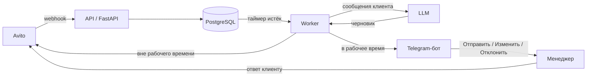

# CareService Automation

Сервис отвечает на первые сообщения клиентов в чатах Avito (услуги по уходу за людьми). Входящее сообщение принимает FastAPI, текст ответа генерирует LLM через OpenAI-compatible API, а менеджер проверяет черновик в Telegram и одним нажатием отправляет его клиенту.

> Вне рабочего времени сервис отвечает клиенту **без участия менеджера**. Расписание сейчас отключено (функция `is_working_time()` всегда возвращает `True`), поэтому все ответы идут через модерацию. Подробности - в разделе [Рабочее время и автоответ](#рабочее-время-и-автоответ).

## Содержание

- [Как это работает](#как-это-работает)
- [Рабочее время и автоответ](#рабочее-время-и-автоответ)
- [Быстрый старт](#быстрый-старт)
- [Конфигурация](#конфигурация)
- [Интеграции](#интеграции)
- [Промпт модели](#промпт-модели)
- [Структура проекта](#структура-проекта)
- [База данных и миграции](#база-данных-и-миграции)
- [Деплой](#деплой)
- [Диагностика](#диагностика)
- [Особенности и ограничения](#особенности-и-ограничения)
- [Безопасность](#безопасность)

## Как это работает



1. Avito присылает событие на `POST /avito/webhook`. Обрабатываются только события `payload.type = message`.
2. Если автор сообщения - ваш аккаунт (`AVITO_ACCOUNT_ID`), чат помечается как отвеченный.
3. Для сообщения клиента сервис проверяет через Avito API, нет ли в чате уже исходящих сообщений. Если есть - чат пропускается.
4. Первое сообщение нового чата создаёт запись в БД и запускает таймер на `DEBOUNCE_SECONDS`. Сообщения, пришедшие до конца таймера, сохраняются; сам таймер не сдвигается. Сообщения после окончания окна игнорируются.
5. Worker раз в секунду забирает чаты с истёкшим таймером (до 10 за проход) и склеивает все входящие сообщения клиента в один текст.
6. Текст уходит в LLM, модель возвращает короткий ответ.
7. В рабочее время черновик отправляется модераторам в Telegram. Менеджер нажимает **✅ Отправить**, **✏️ Изменить** или **❌ Отклонить**.
8. Если обработка чата завершилась ошибкой, он возвращается в очередь через минуту.

### Статусы ответа webhook

Эндпоинт всегда отвечает `200` и возвращает `{"ok": true, "status": "..."}`:

| Статус | Значение |
|---|---|
| `recorded` | сообщение клиента сохранено |
| `duplicate` | сообщение с таким Avito ID уже есть |
| `answered` | это сообщение от вашего аккаунта, чат помечен отвеченным |
| `ignored_already_replied` | в чате уже есть исходящее сообщение |
| `ignored` | событие не подходит: не сообщение, нет текста, чат уже отвечен или окно задержки закрыто |

## Рабочее время и автоответ

В `src/utils/work_time.py` функция `is_working_time()` решает, нужна ли модерация:

- `True` - черновик уходит менеджеру в Telegram;
- `False` - ответ отправляется клиенту автоматически, в БД он сохраняется со статусом `auto_sent`.

Сейчас функция всегда возвращает `True`: расписание закомментировано на время тестов. В закомментированном варианте рабочее время - будни с 9:00 до 18:00 по Москве. Чтобы включить автоответ, раскомментируйте проверку в этом файле.

## Быстрый старт

### Требования

- Docker Engine и Docker Compose v2
- приложение Avito (Client ID и Client Secret) и ID вашего аккаунта
- Telegram-бот и chat ID модераторов
- API-ключ и endpoint LLM-провайдера, совместимого с OpenAI API

Для запуска без Docker нужны Python 3.12 и [uv](https://docs.astral.sh/uv/).

### Запуск в Docker

```bash
# 1. Настройте окружение
cp .env.example .env
# заполните .env, см. раздел «Конфигурация»

# 2. Соберите образы и запустите базу данных
docker compose build
docker compose up -d postgres

# 3. Примените миграции
docker compose run --rm app .venv/bin/alembic upgrade head

# 4. Запустите API, worker и бота
docker compose up -d app worker bot
```

Проверка:

1. `docker compose ps` - все четыре сервиса в статусе `running`.
2. `http://127.0.0.1:8000/docs` - открывается Swagger UI.
3. `docker compose logs --tail=50 bot` - нет ошибок авторизации Telegram.
4. Напишите в Avito-чат аккаунта с другого аккаунта и подождите `DEBOUNCE_SECONDS` - в чате модерации появится черновик.

Остановка:

```bash
docker compose down      # данные БД сохраняются
docker compose down -v   # удаляет том PostgreSQL вместе с данными
```

### Запуск без Docker

```bash
uv sync
cp .env.example .env     # укажите DATABASE_HOST=localhost
uv run alembic upgrade head
```

Затем в отдельных терминалах:

```bash
uv run uvicorn src.main:app --reload --host 127.0.0.1 --port 8000
uv run python -m src.worker
uv run python -m src.bot.main
```

## Конфигурация

Настройки читаются из `.env` (шаблон - `.env.example`) через Pydantic Settings.

| Переменная | Обязательна | Описание |
|---|---|---|
| `POSTGRES_DB` | да | имя базы данных |
| `POSTGRES_USER` | да | пользователь PostgreSQL |
| `POSTGRES_PASSWORD` | да | пароль PostgreSQL |
| `POSTGRES_PORT` | нет | порт PostgreSQL, по умолчанию `5432` |
| `DATABASE_HOST` | нет | хост БД, по умолчанию `localhost`; в Compose для `app`, `worker` и `bot` подставляется `postgres` |
| `AVITO_ACCOUNT_ID` | да | числовой ID вашего аккаунта Avito |
| `AVITO_CLIENT_ID` | да | Client ID приложения Avito |
| `AVITO_CLIENT_SECRET` | да | Client Secret приложения Avito |
| `OPENAI_API_KEY` | да | ключ LLM-провайдера |
| `OPENAI_BASE_URL` | да | base URL OpenAI-compatible API |
| `TELEGRAM_BOT_TOKEN` | да | токен Telegram-бота |
| `TELEGRAM_MODERATOR_CHAT_IDS` | да | chat ID модераторов в формате JSON, например `[123456789,987654321]` |
| `DEBOUNCE_SECONDS` | да | задержка перед обработкой нового чата, в секундах (например, `180`); пустое значение приведёт к ошибке запуска |
| `PROJECT_NAME` | нет | заголовок в Swagger UI |
| `API_PREFIX` | нет | префикс всех маршрутов; если задан, webhook доступен по `{API_PREFIX}/avito/webhook` |

> [!NOTE]
> Переменные `AVITO_ACCESS_TOKEN`, `OPENROUTER_API_KEY` и `OPENROUTER_BASE_URL` описаны в настройках, но код их не использует. Токен Avito сервис получает сам по `client_credentials` и обновляет за 5 минут до истечения.

> [!NOTE]
> PostgreSQL применяет `POSTGRES_*` только при первой инициализации тома `postgres_data`. Если том уже существует, смена пароля в `.env` не изменит пароль в базе.

## Интеграции

### Avito

- Webhook: `POST /avito/webhook`. В настройках приложения Avito укажите `https://<ваш-домен>/avito/webhook`, нужен HTTPS.
- Для локальной разработки используйте туннель с публичным HTTPS-адресом.
- Приложению нужен доступ к Messenger API и подписка на события сообщений.

### Telegram

- Бот использует long polling. С одним токеном должен работать только один экземпляр, иначе Telegram вернёт `TelegramConflictError`.
- Чтобы узнать chat ID модератора, отправьте боту `/start` - он ответит вашим ID. Добавьте ID в `TELEGRAM_MODERATOR_CHAT_IDS`.
- Кнопки под черновиком:
  - **✅ Отправить** - отправить текст клиенту в Avito;
  - **✏️ Изменить** - прислать новый текст; черновик обновится, а кнопки вернутся, и для отправки нужно нажать **✅ Отправить**;
  - **❌ Отклонить** - отменить черновик.
- Черновик получают все модераторы из списка. Первое нажатие переводит черновик в обработанный, остальным придёт уведомление, что он уже обработан.

## Промпт модели

Системный промпт, шаблоны ответов и цены на услуги заданы константой `SYSTEM_PROMPT` в `src/services/ai_service.py`. Модель `deepseek-flash` указана в том же файле. Чтобы изменить цены или стиль ответов, редактируйте этот файл и перезапустите сервисы `worker` и `bot`.

Пары «сообщение клиента - ответ модели» пишутся в лог отдельным логгером `ai_dialog`.

## Структура проекта

```text
.
├── src/
│   ├── api/          # маршруты FastAPI, webhook Avito
│   ├── bot/          # Telegram-бот: хендлеры, клавиатуры, тексты
│   ├── core/         # настройки, подключение к БД, базовая модель
│   ├── crud/         # запросы к БД
│   ├── models/       # SQLAlchemy-модели
│   ├── schemas/      # разбор событий Avito
│   ├── services/     # Avito API, LLM, обработка webhook, сценарий ответа
│   ├── utils/        # рабочее время
│   ├── main.py       # FastAPI-приложение
│   └── worker.py     # фоновая обработка чатов
├── alembic/          # миграции БД
├── .github/workflows/deploy.yml
├── Dockerfile
├── docker-compose.yml
├── pyproject.toml
└── .env.example
```

## База данных и миграции

| Таблица | Назначение |
|---|---|
| `chats` | один чат Avito: таймер `waiting_until` и флаг `answered` |
| `messages` | входящие сообщения клиента и ответы, отправленные сервисом |
| `reply_reviews` | предложенный и итоговый ответ; статусы `pending`, `approved`, `edited`, `cancelled`, `auto_sent` |
| `reply_candidates`, `message_batches` | черновики на модерации, с которыми работают кнопки Telegram |
| `incoming_messages`, `chat_processing_states` | таблицы прежней схемы; в текущем сценарии обработки не используются |

Создать миграцию после изменения моделей:

```bash
uv run alembic revision --autogenerate -m "описание изменения"
```

Применить миграции:

```bash
uv run alembic upgrade head
# в Docker:
docker compose run --rm app .venv/bin/alembic upgrade head
```

Перед применением на production проверьте сгенерированную миграцию и сделайте резервную копию БД.

## Деплой

Workflow `.github/workflows/deploy.yml` запускается при push в `main`:

1. синхронизирует проект на сервер в `/root/CareService-automation/` (файл `.env`, `logs/` и `.git` не копируются);
2. выполняет `docker compose build`;
3. запускает `postgres`, затем `app`, `worker` и `bot`.

Секреты репозитория в GitHub Actions: `SSH_HOST`, `SSH_USER`, `SSH_KEY`.

Что нужно знать:

- Файл `.env` создаётся на сервере вручную и при деплое не перезаписывается.
- **Миграции при деплое не запускаются.** После первого деплоя и после каждого изменения схемы выполните на сервере `docker compose run --rm app .venv/bin/alembic upgrade head`.
- Сервис `app` в `docker-compose.yml` запущен с `--reload` и монтирует `./src`. Это режим разработки, на production лучше убрать `--reload` и bind-mount.

## Диагностика

```bash
docker compose ps
docker compose logs --tail=200 app      # или worker, bot
docker compose exec postgres pg_isready -U "$POSTGRES_USER" -d "$POSTGRES_DB"
```

| Проблема | Что проверить |
|---|---|
| Сервис падает при старте | заполнены ли обязательные переменные; `DEBOUNCE_SECONDS` должна быть числом |
| Ошибка аутентификации PostgreSQL | `POSTGRES_*` и состояние тома `postgres_data` |
| `relation does not exist` | применены ли миграции |
| Webhook не приходит | доступность HTTPS снаружи, путь `/avito/webhook` (с учётом `API_PREFIX`), подписка на события, логи `app` |
| Webhook приходит, ответа нет | статус в ответе webhook (таблица выше), логи `worker`, значение `DEBOUNCE_SECONDS` |
| Нет черновиков в Telegram | `TELEGRAM_MODERATOR_CHAT_IDS`, токен бота, был ли у модератора диалог с ботом (`/start`), логи `bot` и `worker` |
| Ошибка LLM | `OPENAI_API_KEY`, `OPENAI_BASE_URL`, доступна ли модель `deepseek-flash` у провайдера |
| `TelegramConflictError` | остановите лишние процессы и контейнеры с тем же токеном бота |
| Ошибка отправки в Avito | логи `bot`, права приложения Avito на Messenger API |

## Особенности и ограничения

- Модель видит только сообщения клиента, которые сервис сохранил после первого сообщения в чате. История чата и прошлые ответы из Avito в контекст не попадают.
- Сервис отвечает на первое обращение в новом чате. Сообщения, пришедшие после окончания окна `DEBOUNCE_SECONDS`, игнорируются.
- Таймер задаётся один раз по первому сообщению и не продлевается новыми сообщениями.
- Кнопки Telegram обновляют `reply_candidates`. Запись в `reply_reviews` при этом остаётся в статусе `pending`; её статус меняется только при автоответе или отмене из-за ошибки отправки на модерацию.
- Автоматических тестов в репозитории нет (каталог `tests/` пуст).

## Безопасность

- Не коммитьте `.env`, токены, пароли и SSH-ключи. Файл `.env` уже указан в `.gitignore`.
- Ограничьте доступ к серверу, PostgreSQL и чату модерации.
- Используйте HTTPS для публичного webhook.
- В логи и БД попадают тексты переписки с клиентами. Не публикуйте их без очистки персональных данных.
- Перед включением автоответа проверьте промпт, цены и поведение модели на тестовых диалогах.
